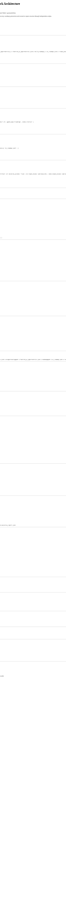
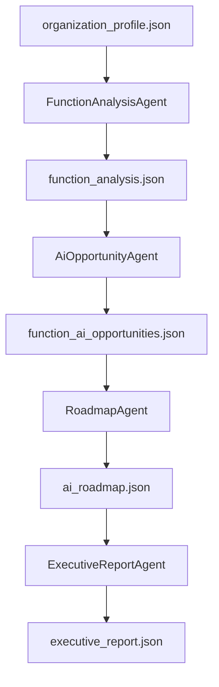
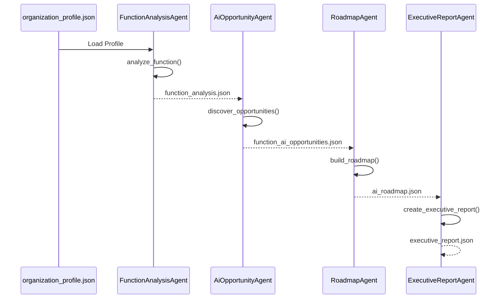
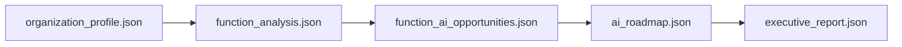
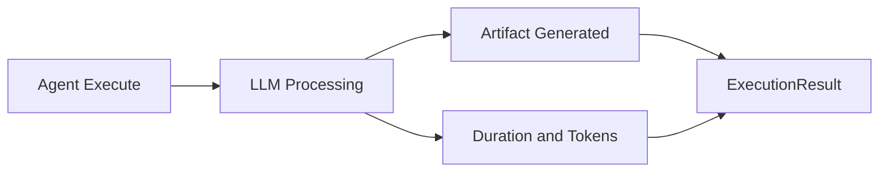
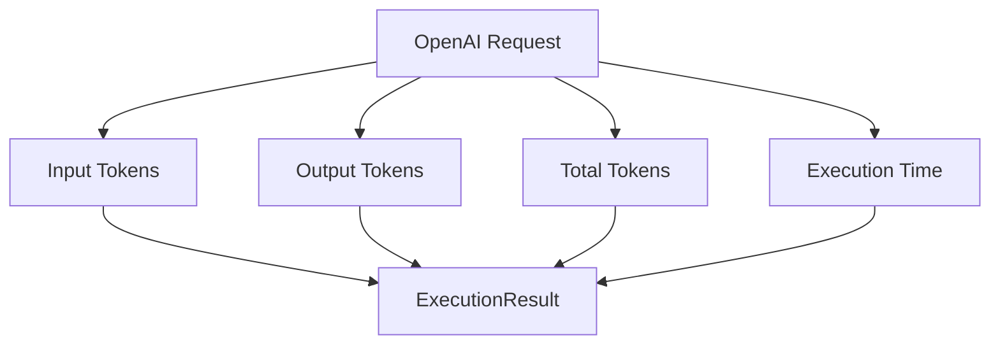
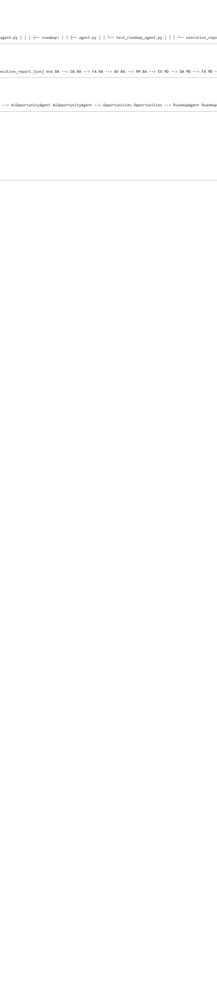
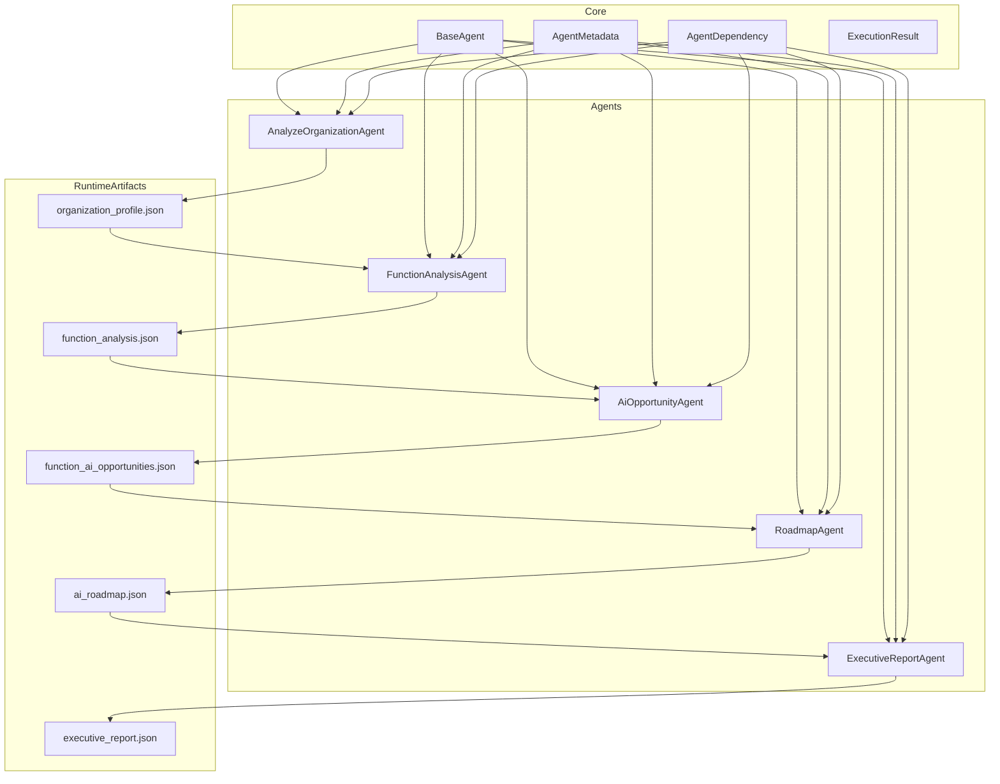
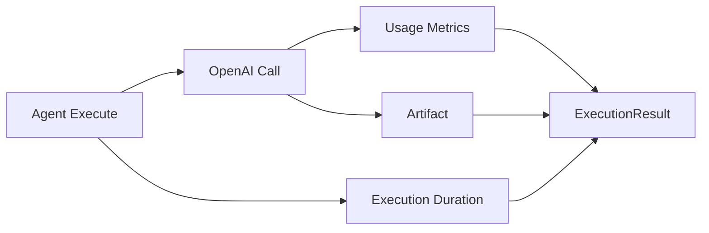

להלן קובץ ARCHITECTURE_OVERVIEW.md מוכן להעתקה לריפו.

# AI Enabler - Multi-Agent Framework Architecture

## Overview

This project evolved from a collection of standalone AI scripts into a structured Multi-Agent platform.

The original implementation executed business analysis, AI opportunity discovery, roadmap generation and executive report creation through independent scripts.

The new architecture introduces:

- Agent abstraction
- Agent metadata
- Dependency management
- Artifact management
- Execution tracking
- Runtime telemetry
- End-to-end orchestration

---

# Architecture Evolution

## Original Design

The original solution was script-oriented.

```text
organization_profile.json
        ↓

analyze_function()

        ↓

analysis

        ↓

discover_opportunities()

        ↓

function_ai_opportunities.json

        ↓

build_roadmap()

        ↓

ai_roadmap.json

        ↓

create_executive_report()

        ↓

executive_report.json
```

Each stage worked independently.

There was no common runtime contract.

No unified execution model existed.

---

# New Agent Architecture

All business capabilities are now wrapped inside agents.

Every agent implements:

```python
BaseAgent
```

and exposes:

```python
metadata
dependencies
tools
execute()
```

---

# Core Components

## BaseAgent

Provides a common contract.

```python
class BaseAgent
```

All agents inherit from this class.

---

## AgentMetadata

Describes the agent.

Example:

```python
AgentMetadata(
    agent_id="roadmap",
    agent_name="Roadmap Agent",
    version="1.0",
    agent_type="Planning",
    status="Active"
)
```

Purpose:

- Identification
- Documentation
- Registry support

---

## AgentDependency

Describes inputs and outputs.

Example:

```python
AgentDependency(
    requires=[
        "function_ai_opportunities.json"
    ],
    produces=[
        "ai_roadmap.json"
    ]
)
```

Purpose:

- Dependency discovery
- Validation
- Orchestration support

---

## ExecutionResult

Unified runtime result.

Current structure:

```python
@dataclass
class ExecutionResult:

    status: str
    agent_id: str

    output_artifact: str

    duration_seconds: float = 0.0

    input_tokens: Optional[int] = None
    output_tokens: Optional[int] = None
    total_tokens: Optional[int] = None

    errors: list[str]
```

Purpose:

- Success/failure status
- Runtime metrics
- Token tracking
- Error handling

---

# Agent Pipeline

The system currently consists of four operational agents.

---

## 1. FunctionAnalysisAgent

### Input

```text
organization_profile.json
```

### Processing

For every business function:

```python
analyze_function()
```

is executed.

### Output

```text
function_analysis.json
```

### Artifact Structure

```json
{
  "function_insights": [
    {
      "function_name": "...",
      "analysis": {}
    }
  ]
}
```

---

## 2. AiOpportunityAgent

### Input

```text
function_analysis.json
```

### Processing

For each function:

```python
discover_opportunities()
```

is executed.

### Output

```text
function_ai_opportunities.json
```

### Purpose

Discovers and prioritizes AI opportunities.

---

## 3. RoadmapAgent

### Input

```text
function_ai_opportunities.json
```

### Processing

```python
build_roadmap()
```

### Output

```text
ai_roadmap.json
```

### Purpose

Generate implementation roadmap.

---

## 4. ExecutiveReportAgent

### Input

```text
ai_roadmap.json
```

### Processing

```python
create_executive_report()
```

### Output

```text
executive_report.json
```

### Purpose

Generate executive-level summary.

---

# Runtime Flow

```text
organization_profile.json
        ↓

FunctionAnalysisAgent
        ↓

function_analysis.json
        ↓

AiOpportunityAgent
        ↓

function_ai_opportunities.json
        ↓

RoadmapAgent
        ↓

ai_roadmap.json
        ↓

ExecutiveReportAgent
        ↓

executive_report.json
```

---

# Telemetry Implementation

Telemetry was added to provide visibility into:

- Execution time
- Token consumption
- Cost drivers

Every agent now reports:

```python
duration_seconds

input_tokens

output_tokens

total_tokens
```

through:

```python
ExecutionResult
```

---

# Example Runtime Output

```text
Function Analysis Agent

Duration:
22.31 sec

Total Tokens:
1617
```

```text
AI Opportunity Agent

Duration:
54.19 sec

Total Tokens:
4564
```

```text
Roadmap Agent

Duration:
18.14 sec

Total Tokens:
4340
```

```text
Executive Report Agent

Duration:
14.68 sec

Total Tokens:
1769
```

Pipeline Total:

```text
Total Time:
109.32 sec

Total Tokens:
12290
```

---

# Key Architectural Decisions

## Why Use Artifacts?

Earlier stages exchanged data in memory.

Example:

```python
analysis["result"]
```

was passed directly between functions.

The new architecture stores outputs as explicit artifacts.

Example:

```text
function_analysis.json
```

Benefits:

- Reproducibility
- Easier debugging
- Independent execution
- Restart capability
- Auditability

---

## Why Keep JSON Files?

Future production deployment may replace files with:

```python
context
```

or

```python
shared memory
```

However artifacts currently provide:

- Traceability
- Replay capability
- Easier troubleshooting

during framework maturation.

---

# Testing

Current integration test:

```text
test_all_agents.py
```

Responsibilities:

- Execute entire pipeline
- Validate artifacts
- Display telemetry
- Detect failures

Validation includes:

```text
function_analysis.json

function_ai_opportunities.json

ai_roadmap.json

executive_report.json
```

---

# Current Status

Completed:

✅ Agent Framework

✅ Agent Metadata

✅ Dependency Management

✅ Execution Result

✅ Telemetry

✅ FunctionAnalysisAgent

✅ AiOpportunityAgent

✅ RoadmapAgent

✅ ExecutiveReportAgent

✅ Artifact Pipeline

✅ End-to-End Execution

---

# Next Possible Enhancements

## AnalyzeOrganizationAgent Runtime

Connect remaining initialization agent to framework.

---

## Agent Registry Driven Pipeline

Instead of manually defining:

```python
pipeline = [...]
```

build execution graph dynamically from:

```python
dependencies
```

---

## Dependency Validation

Validate required artifacts before execution.

Example:

```python
agent.validate_dependencies()
```

---

## Retry Policies

Automatic retries:

```python
OpenAI failures

Network timeouts

Transient errors
```

---

## Context-Based Runtime

Long term target:

```text
Agent
    ↓
Shared Context
    ↓
Agent
```

instead of:

```text
Agent
    ↓
JSON
    ↓
Agent
```

while optionally persisting artifacts for audit purposes.

---

# Milestone

Version:

```text
v0.4-full-agent-pipeline
```

represents the first fully operational end-to-end Multi-Agent implementation with:

- Runtime execution
- Artifact flow
- Telemetry
- Dependency tracking
- Executive output generation


זה מתאר את הפתרון, ההחלטות הארכיטקטוניות, ה־Artifacts, ה־Telemetry, ה־Pipeline והצעדים הבאים ברמת Design Review.

מומלץ להוסיף את החלק הבא ל־ARCHITECTURE_OVERVIEW.md תחת סעיף Architecture Diagram:

# Architecture Diagram

## Logical Architecture



---

## Runtime Pipeline



---

## Agent Dependency Graph



---

## ExecutionResult Lifecycle



---

## Telemetry Flow



---

## Current Production Pipeline


התרשימים האלה יתנו לקורא גם מבט ארכיטקטוני, גם מבט Runtime, גם Dependency Graph וגם את מנגנון ה־Telemetry שהוספתם ב־ExecutionResult. זה נראה מצוין במסמכי GitHub ו־Azure DevOps Markdown. 🚀


בהחלט. הייתי מוסיף למסמך סעיף נוסף בשם:

# Project Structure

The project is organized into layers:

```text
ai-enabler/
│
├── core/
│   │
│   ├── base_agent.py
│   ├── agent_metadata.py
│   ├── agent_dependency.py
│   └── execution_result.py
│
├── agents/
│   │
│   ├── analyze_organization/
│   │   ├── agent.py
│   │   └── test_analyze_organization_agent.py
│   │
│   ├── function_analysis/
│   │   ├── agent.py
│   │   └── test_function_analysis_agent.py
│   │
│   ├── ai_opportunity/
│   │   ├── agent.py
│   │   └── test_ai_opportunity_agent.py
│   │
│   ├── roadmap/
│   │   ├── agent.py
│   │   └── test_roadmap_agent.py
│   │
│   └── executive_report/
│       ├── agent.py
│       └── test_executive_report_agent.py
│
├── organization_analysis.py
├── function_analysis.py
├── ai_opportunity_agent.py
├── roadmap_agent.py
├── executive_report_agent.py
│
├── organization_profile.json
├── function_analysis.json
├── function_ai_opportunities.json
├── ai_roadmap.json
├── executive_report.json
│
├── test_all_agents.py
│
└── ARCHITECTURE_OVERVIEW.md
```

---

# Layered Architecture



---

# Runtime Dependency View

```mermaid
graph LR

    OrganizationProfile[organization_profile.json]

    FunctionAnalysisAgent

    FunctionAnalysis[function_analysis.json]

    AiOpportunityAgent

    Opportunities[function_ai_opportunities.json]

    RoadmapAgent

    Roadmap[ai_roadmap.json]

    ExecutiveReportAgent

    ExecutiveReport[executive_report.json]

    OrganizationProfile --> FunctionAnalysisAgent

    FunctionAnalysisAgent --> FunctionAnalysis

    FunctionAnalysis --> AiOpportunityAgent

    AiOpportunityAgent --> Opportunities

    Opportunities --> RoadmapAgent

    RoadmapAgent --> Roadmap

    Roadmap --> ExecutiveReportAgent

    ExecutiveReportAgent --> ExecutiveReport
```



---

# Agent Responsibilities

| Agent | Input | Output | Purpose |
|----------|----------|----------|----------|
| AnalyzeOrganizationAgent | Raw Organization Data | organization_profile.json | Organization profiling |
| FunctionAnalysisAgent | organization_profile.json | function_analysis.json | Business function analysis |
| AiOpportunityAgent | function_analysis.json | function_ai_opportunities.json | AI opportunity discovery |
| RoadmapAgent | function_ai_opportunities.json | ai_roadmap.json | AI implementation roadmap |
| ExecutiveReportAgent | ai_roadmap.json | executive_report.json | Executive summary generation |

---

# Telemetry Flow




התרשים הזה משלים יפה את המסמך כי הוא מציג גם את מבנה התיקיות, גם את שכבות המערכת, גם את זרימת ה־Artifacts וגם את מנגנון ה־Telemetry שהוספתם.